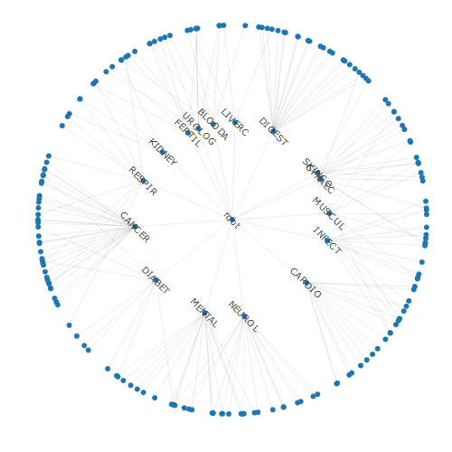
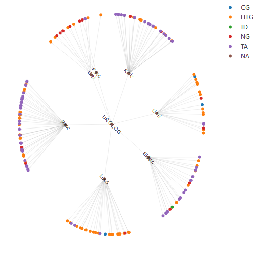
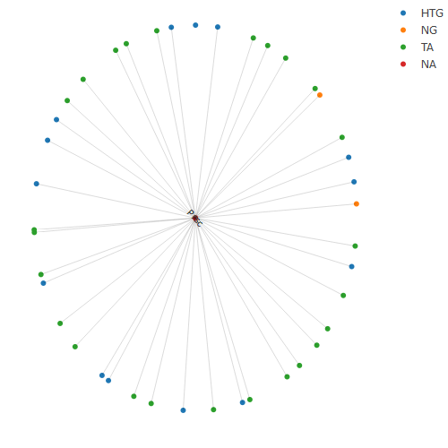

<!-- README.md is generated from README.Rmd. Please edit that file -->

# visNICE

<!-- badges: start -->

[](https://github.com/jnm212/visNICE/actions/workflows/R-CMD-check.yaml)
<!-- badges: end -->

The goal of visNICE is to display the a list publications produced by
NICE (UK National Institute for Health and Care Excellence) in the form
of network graphs. The list of publications can be found (and browsed
with list boxes) at:

<https://www.nice.org.uk/guidance/conditions-and-diseases>

visNICE produces those results in a graphical form as an alternative
means of browsing. The current version of visNICE organises the networks
in the hierarchy produced by NICE.

Each NICE report has a prefix which indicates its type, as follows:

- NG - Nice Guidance
- TA - Technology Assessment
- HST - Highly Specialised Technology
- CSG - Cancer Service Guideline
- HTG - HealthTech Guidance
- CG - Clinical Guideline

## Installation

You can install the development version of visNICE from
[GitHub](https://github.com/) with:

``` r
# install.packages("pak")
pak::pak("jnm212/visNICE")
```

## Examples

First we make a tree that holds all the information. Typing the name of
the tree gives a summary of the hierarchy, including a list of nodes in
the first layer:

``` r
library(visNICE)

h <- nicetree()
(h) # summarise
#> 
#>  total number of nodes:  4871
#>  total number of levels (excluding 0):  
#>  number of nodes by level :
#>    0    1    2    3 
#>    1   16  176 4679 
#> 
#>  Root node :  root ( root )
#>  First layer nodes : BLOODA CANCER CARDIO DIABET DIGEST FERTIL GYNAEC INFECT KIDNEY LIVERC MENTAL MUSCUL NEUROL RESPIR SKINCO UROLOG
```

We could plot the whole tree, but because that operation is too
time-consuming, visNICE restricts the full-tree plot to the top layers.

``` r
plot(h) 
#> Plotting the whole tree is too time-consuming; restricting to upper levels
#> Remember you can hover over nodes to see text
```



Now we can take a ‘cutting’ from the tree, which means there is less
information to display, and the whole cutting or subtree will be shown.
Here we choose urological conditions (UROLOG) as the root node. First we
make a new smaller tree with the cutting command, summarise it, and then
plot it. When used interactively, Hovering over the nodes in the tree
would show the listed reports.

``` r
h_uro <- cutting(h, "UROLOG")
h_uro
#> 
#>  total number of nodes:  156
#>  total number of levels (excluding 0):  
#>  number of nodes by level :
#>   1   2   3 
#>   1   7 149 
#> 
#>  Root node :  UROLOG ( Urological conditions )
#>  First layer nodes : Blddc Luts Patc Prsc Rnlc Urni Urti
plot(h_uro)
#> Remember you can hover over nodes to see text
```



You might want to look at a ‘more specific’ node. Here we use an
alternative command with a pipe (\|\>), to avoid creating an extra
object (the smaller tree).

``` r

cutting(h, "Prsc") |> plot()
#> Remember you can hover over nodes to see text
```


